<a href="https://www.sakarkhadka.com.np"><picture><source media="(max-width: 600px)" srcset="assets/notebook-cover-mobile.svg" />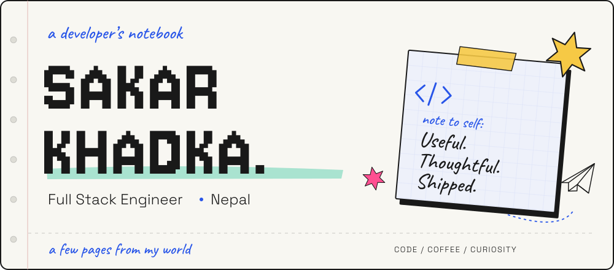</picture></a>

  <strong>I build digital things that look good, feel right, and actually work.</strong> 
  <a href="https://www.sakarkhadka.com.np">Portfolio ↗</a> &nbsp; / &nbsp;
  <a href="https://www.linkedin.com/in/sakarkhadka10">LinkedIn</a> &nbsp; / &nbsp;
  <a href="mailto:khadka.sakar10@gmail.com">Say hello</a> &nbsp; / &nbsp;
  <a href="https://www.sakarkhadka.com.np/resume.pdf">Résumé</a>

<picture><source media="(max-width: 600px)" srcset="assets/heading-projects-mobile.svg" />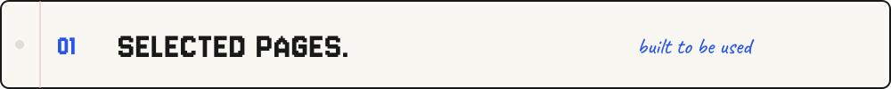</picture>

  <a href="https://www.munalonline.com"><picture><source media="(max-width: 600px)" srcset="assets/projects/munal-mobile.svg" />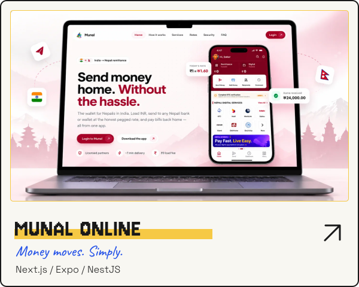</picture></a>
  <a href="https://xenonepal.com"><picture><source media="(max-width: 600px)" srcset="assets/projects/xeno-mobile.svg" />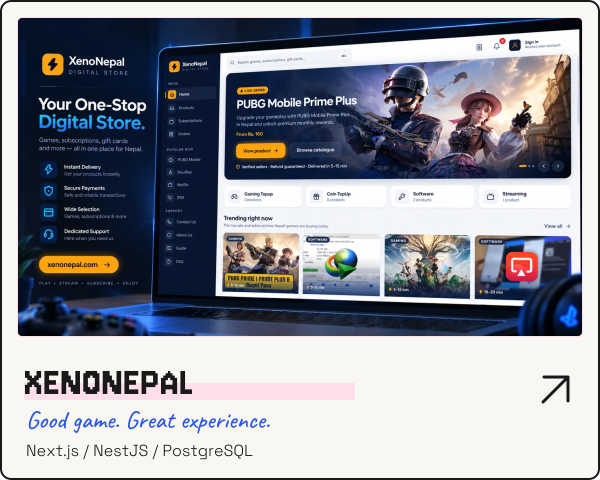</picture></a> 
  <a href="https://www.merokarya.com"><picture><source media="(max-width: 600px)" srcset="assets/projects/merokarya-mobile.svg" />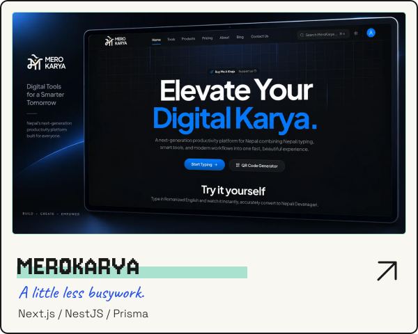</picture></a>
  <a href="https://everest-massage.vercel.app"><picture><source media="(max-width: 600px)" srcset="assets/projects/everest-mobile.svg" />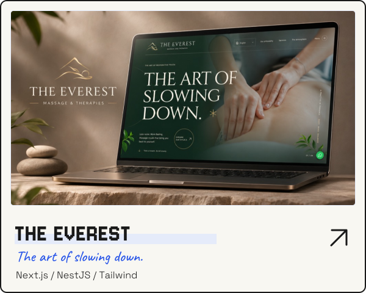</picture></a>

<a href="https://www.sakarkhadka.com.np/projects">Explore the full project notebook ↗</a>

<picture><source media="(max-width: 600px)" srcset="assets/heading-skills-mobile.svg" />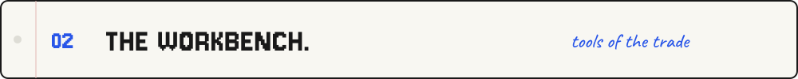</picture>
<picture><source media="(max-width: 600px)" srcset="assets/workbench-mobile.svg" />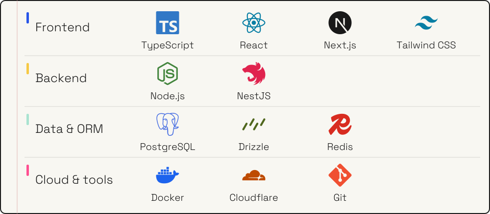</picture>

<picture><source media="(max-width: 600px)" srcset="assets/heading-activity-mobile.svg" />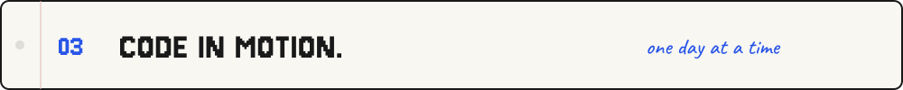</picture>
<a href="https://github.com/sakarkhadka10?tab=overview"><picture><source media="(max-width: 600px)" srcset="assets/activity-mobile.svg" />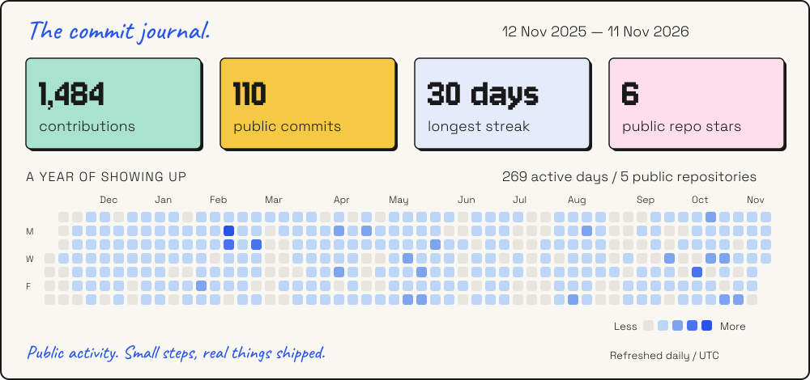</picture></a>
<picture><source media="(max-width: 600px)" srcset="assets/activity-month-mobile.svg" /></picture>

Real public activity · trailing 365 days · refreshed daily · <a href="assets/activity.json">view the numbers</a>

<picture><source media="(max-width: 600px)" srcset="assets/heading-opensource-mobile.svg" />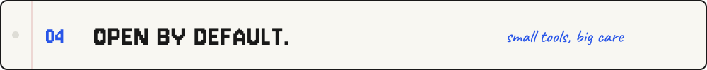</picture>
<picture><source media="(max-width: 600px)" srcset="assets/opensource-mobile.svg" />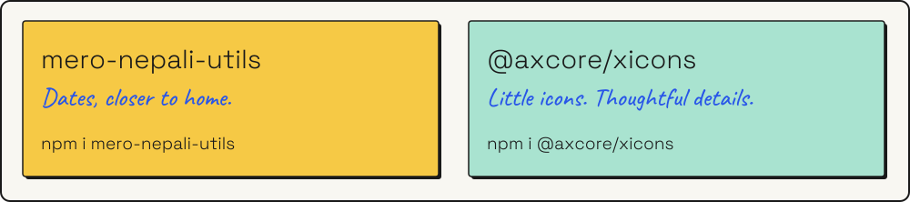</picture>

  <a href="https://github.com/sakarkhadka10/mero-nepali-utils">mero-nepali-utils ↗</a> &nbsp; / &nbsp;
  <a href="https://github.com/sakarkhadka10/xicons">@axcore/xicons ↗</a>

<picture><source media="(max-width: 600px)" srcset="assets/heading-play-mobile.svg" />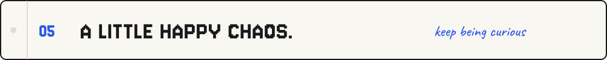</picture>
<a href="https://www.sakarkhadka.com.np/playground"><picture><source media="(max-width: 600px)" srcset="assets/kite-mobile.svg" />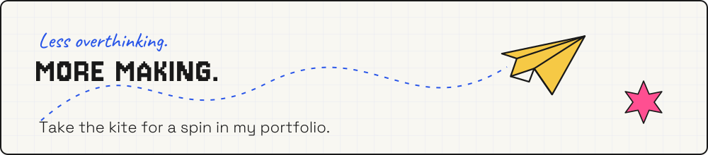</picture></a>

  <a href="https://github.com/yalongwastaken/git-koi">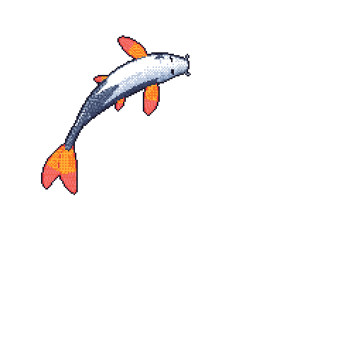</a> 
  The notebook’s resident koi. A little more code, a little more life. <a href="https://github.com/yalongwastaken/git-koi">git-koi ↗</a>

<a href="mailto:khadka.sakar10@gmail.com"><picture><source media="(max-width: 600px)" srcset="assets/notebook-footer-mobile.svg" />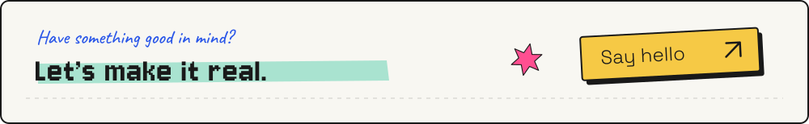</picture></a>

<a href="mailto:khadka.sakar10@gmail.com">khadka.sakar10@gmail.com</a> &nbsp; · &nbsp; <a href="https://www.sakarkhadka.com.np">sakarkhadka.com.np</a>

